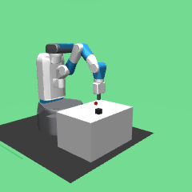
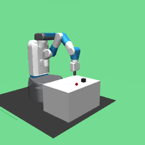
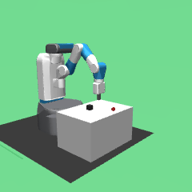
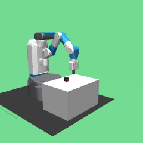
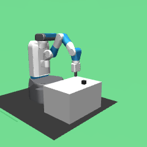

# Results

100 held-out episodes per run (seeds 10000-10099), Wilson 95% intervals. Commit `uncommitted`, Python 3.12.3.

## Success rate vs. hand-tracking noise and smoothing window

| noise (jitter, dropout) | no smoothing (k=1) | k=5 | k=9 |
|---|---|---|---|
| clean (0.2 cm, 0%) | 0.95 [0.89, 0.98] | 0.98 [0.93, 0.99] | 1.00 [0.96, 1.00] |
| phone (1.0 cm, 10%) | 0.78 [0.69, 0.85] | 0.97 [0.92, 0.99] | 1.00 [0.96, 1.00] |
| poor (2.0 cm, 15%) | 0.41 [0.32, 0.51] | 0.96 [0.90, 0.98] | 0.97 [0.92, 0.99] |
| bad (3.0 cm, 20%) | 0.14 [0.09, 0.22] | 0.78 [0.69, 0.85] | 0.86 [0.78, 0.91] |
| very_bad (4.5 cm, 30%) | 0.07 [0.03, 0.14] | 0.48 [0.38, 0.58] | 0.68 [0.58, 0.76] |

## Baselines

| run | success | 95% CI |
|---|---|---|
| oracle | 1.00 | [0.96, 1.00] |
| replay_phone_k5 | 0.97 | [0.92, 0.99] |
| naive_phone_k5 | 0.04 | [0.02, 0.10] |

## Failure modes (counts out of 100)

| run | success | never_grasped | dropped_in_transit | missed_goal | retarget_failed |
|---|---|---|---|---|---|
| oracle | 100 | 0 | 0 | 0 | 0 |
| replay_clean_k1 | 95 | 0 | 0 | 5 | 0 |
| replay_clean_k5 | 98 | 0 | 0 | 2 | 0 |
| replay_clean_k9 | 100 | 0 | 0 | 0 | 0 |
| replay_phone_k1 | 78 | 5 | 2 | 15 | 0 |
| replay_phone_k5 | 97 | 0 | 0 | 3 | 0 |
| replay_phone_k9 | 100 | 0 | 0 | 0 | 0 |
| replay_poor_k1 | 41 | 32 | 5 | 22 | 0 |
| replay_poor_k5 | 96 | 2 | 0 | 2 | 0 |
| replay_poor_k9 | 97 | 1 | 0 | 2 | 0 |
| replay_bad_k1 | 14 | 58 | 5 | 23 | 0 |
| replay_bad_k5 | 78 | 6 | 2 | 14 | 0 |
| replay_bad_k9 | 86 | 8 | 0 | 5 | 1 |
| replay_very_bad_k1 | 7 | 54 | 10 | 29 | 0 |
| replay_very_bad_k5 | 48 | 23 | 4 | 25 | 0 |
| replay_very_bad_k9 | 68 | 18 | 0 | 11 | 3 |
| naive_phone_k5 | 4 | 93 | 0 | 3 | 0 |

## Gallery

**replay_phone_k5**, success (seed 10000)  

**replay_phone_k5**, missed_goal (seed 10022)  

**replay_bad_k1**, success (seed 10007)  

**replay_bad_k1**, never_grasped (seed 10000)  

**replay_bad_k1**, dropped_in_transit (seed 10045)  

**replay_bad_k1**, missed_goal (seed 10001)  

**replay_very_bad_k5**, success (seed 10000)  

**replay_very_bad_k5**, never_grasped (seed 10005)  

**replay_very_bad_k5**, dropped_in_transit (seed 10012)  

**replay_very_bad_k5**, missed_goal (seed 10007)  

**naive_phone_k5**, success (seed 10016)  

**naive_phone_k5**, never_grasped (seed 10000)  

**naive_phone_k5**, missed_goal (seed 10023)  

